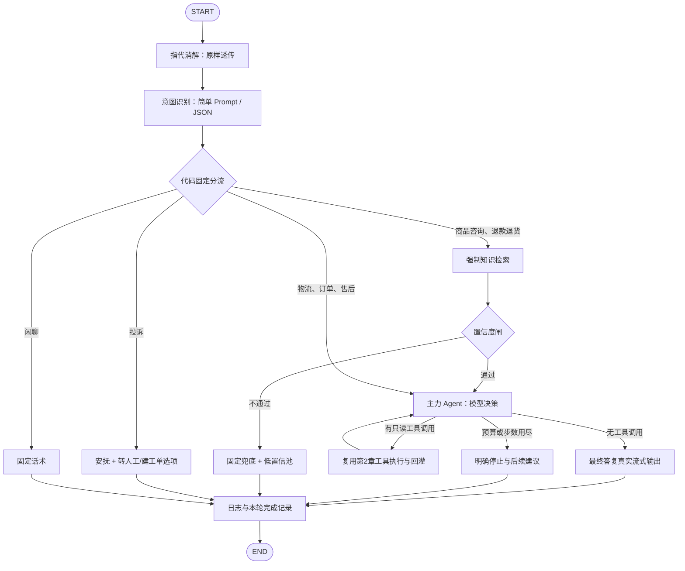

# 第五章：确定性 Workflow 与主力 Agent 设计草案

日期：2026-11-05。状态：独立 builder check 已通过，待用户审批；未开始安装依赖或产品实现。审查记录见 `docs/superpowers/reviews/2026-11-05-ch05-design-builder-check.md`。

## 目标、固定约束与范围

将现有 `/api/chat/stream` 原位升级为确定性 Workflow：指代消解 → 意图识别 → 按意图分流 → 必要的强制检索与置信度闸 → 主力 Agent/固定回复 → 日志记录。先实现一个不用 Agent 编排框架的裸循环，再用 LangGraph StateGraph 重构；保留可运行的教学演示和对应验证，业务主入口最终运行图版本。

用户锁定 LangGraph、贯穿全程的 State、自带 AsyncSqliteSaver（langgraph-checkpoint-sqlite）、独立 SQLite 文件以及原生 HTML/CSS/JS。MySQL 继续保存工单、低置信池和消息日志。复用第2章业务工具和第3/4章检索器，不新增业务工具。保持现有登录/身份边界、上下文裁剪策略，不引入 MCP、正式指代消解/意图识别、飞轮入库、生产人工系统和新可观测平台。

架构按生产方向演进，但现有订单/商品/物流工具仍为随机演示数据，浏览器 user_id 仍不是登录鉴权。官方参考明确 AsyncSqliteSaver 不推荐生产负载；本章按用户选型实现本地持久化与恢复验证，不将其称为高并发生产就绪或跨库原子事务系统。

## 已确定的口径与方案

用户于本轮澄清：“闲聊仍调用一次意图分类模型，分类后返回固定话术，不调用主力 Agent”。不增加本地闲聊关键词白名单。

沿用现有 ChatService 的会话归属校验、短事务、SSE 和工具注册表；新增小型裸循环，再把循环的模型决策/工具执行组成 LangGraph 子流程。确定性节点在图上显式可见，分流为代码中的固定映射。

这是固定技术栈及验收入口下的主方案。另建聊天入口会重复维护会话且无法证明原聊天页升级；直接使用预制 Agent 会跳过裸循环热身；让 Agent 自选是否检索无法保证政策类必经检索。以上替代方案不采用。这里的实现细节均为作者提案，随本文交用户审批，不能描述为已经获得用户逐项选择。

## 图与七类固定路由

| 意图 JSON 值 | 出口 | 行为 |
| --- | --- | --- |
| 商品咨询、退款退货 | knowledge | 强制检索 → 置信度闸 → 证据足够时进 Agent |
| 物流、订单、售后 | business | 直接进 Agent，自行选择只读业务工具 |
| 投诉 | complaint | 固定安抚文字 + 两个独立建议动作，跳过 Agent |
| 闲聊 | smalltalk | 固定话术，跳过 Agent |

图形结构：

指代消解只透传原问题，不暗中增加改写策略；意图节点以简短 Prompt 结合现有受限历史输出单个严格 JSON 对象，仅接受七个枚举值，拒绝未知字段、截断和无效 JSON。无效分类明确报错，不能悄悄改分类器或默认送 Agent。一个问题只输出一类；Prompt 对投诉优先、退款退货的政策诉求和业务售后的区分用标注样例约束。多意图更复杂策略留后续。

投诉固定安抚拟为“很抱歉给您带来不好的体验，您可以选择转人工客服，或创建工单记录问题。”闲聊固定拟为“您好，我是 RetailQ 购物助手，可以帮您咨询商品、订单、物流及售后问题。”

## 强制检索与前置置信度闸

知识出口直接调用现有 `retrieve_knowledge`/KnowledgeRuntime.retrieve，不让 Agent 决定是否调用 query_faq。退款退货先拿政策证据，再把证据和问题交给 Agent；Agent 可以继续查订单/物流等工具。业务出口不触发预检索或这道闸。

最简闸复用第4章 `DynamicConfidencePolicy.allows` 的相关性分数门槛和语料/模型身份校验；分数不是概率，也不保证问题每个细节均有答案。无候选或低于门槛即兜底，同时以 `retrieval_low_conf` 保存原问题及理由；不调用 Agent。缺少、失配的校准策略和检索服务异常作为配置/运行错误处理，不能伪称为低置信样本或绕过门槛。

本章不新增模型置信度判断或生成后审查阻塞器；第4章 `RAGDecision` 缓冲生成通道不作为新版最终回答通道。以相同语料下的缺失事实、无关问题评估门槛局限并如实记录，不把“相关性通过”说成“已完整验证所有答案事实”。知识 Prompt 要求只据证据作答、缺失细节明确说明、不承诺退款日期。

证据形成有界、可序列化快照，保留来源身份、编号、原文范围和摘要；进入 Agent 前纳入输入预算。复用现有 sources/来源定位能力，适配消息最终完成与引用快照关联；不得把图强制检索伪装成模型自主发出的工具调用。实现需将“工作流检索记录”和“Agent 业务工具记录”区分清楚，历史引用仍可定位旧归档。sources 表示本轮提供给模型的完整有界证据快照，编号保持连续；正文实际引用是其子集，界面仅将正文中实际出现的编号变成引用链接，不能声称快照中每段均被正文使用。知识正文流结束时仅校验引用结构：编号必须存在于本轮快照，有证据的政策回答应带引用。非法编号/缺失必需引用时输出 error、不发 done/sources、不保存为完整回答；已显示的增量标记未完成。这是协议校验，不是生成后置信度审查，不保证事实语义正确，也不补发第二份“修正答案”。

## 裸 Agent 循环与图内 ReAct

裸循环只用现有模型网关与工具注册表，不使用 LangGraph/预制 Agent：调用 LLM → 有工具申请则校验、执行并回灌 ToolMessage → 再调用 → 无申请则输出答案。通过可控上游演示零次、一次及先订单后物流的多次执行，并给出独立命令；随后图化保留同等工具协议与停止条件。可以复用已有 LangChain 消息与 @tool 封装，“不用框架”在此指不使用 Agent/Workflow 编排框架，而非重写原有网关和业务工具。

每轮主力 Agent 单步最多执行一个只读工具。意外并行多个申请拒绝执行，不能执行部分申请。复用 query_order、query_logistics、query_product；知识路径已强制检索，业务路径也不向 Agent 暴露 query_faq，防止 Agent 再次检索绕开闸。create_ticket 不在 Agent 可执行工具白名单内，即使模型伪造其调用也不能执行。

简单物流问题一次 query_logistics 后可收敛；复杂问题由中间工具结果驱动继续 query_order → query_logistics；缺少订单号时追问，不捏造参数。记录步骤、调用 ID、工具名、状态和预算，不要求输出内部思维链。

沿用现有“工具选择调用 + 最终无工具生成流”网关模式：决策调用的文本不向用户流出；无工具申请时转入最终无工具流式生成。这样保留真实上游增量，且不会把已经生成的完整文本拆字伪装成流式。接受最终生成额外一次模型调用，将其计入预算；不声称无工具收敛只有一次模型请求。

建议默认每轮最多4次工具执行、6次主力模型调用（含最终流）、整体120秒；另设全轮累计 token 预算与每请求输入/输出上限。参数可配置，由实现阶段根据既有8192上下文窗口验证默认值兼容，不升级上下文管理策略。优先记录上游 usage，缺失时采用现有保守 UTF-8 估算并标明估算值，不能当成精确计费。分类和检索中的模型消耗另列并纳入全轮核算。每个模型调用前检查剩余预算并限制输出；无预算时明确停止，不能继续无界调用或编造成功结果。

保留 call ID 校验、完整申请/回执配对、超时、只读有限重试、重复工具循环检测以及模型失败的脱敏错误。正常 stop 才保存为完整答复；length、取消、EOF、异常终止不保存为完整答复。done 只在本轮成功落库与必要 checkpoint 完成后发送。

## State、checkpointer 与 MySQL 的职责

State 全程贯穿：用户/会话/turn 身份、原问题与透传问题、受限消息、意图和固定出口、证据快照与闸结果、Agent 步数/调用 ID/预算、最终文本/结束原因、可选动作、已持久化消息 ID 和步骤日志。只存可序列化数据/消息，不把服务实例、数据库 Session、客户端、锁或 generator 存进 checkpoint。

AsyncSqliteSaver 在应用 lifespan 内打开并关闭，独立文件拟放 `artifacts/workflow/checkpoints.sqlite`，路径可配置、排除版本控制。thread_id 服务端由数据库身份、会话 ID 组成；读取前始终做现有 user_id 归属校验，客户端不能传任意 checkpoint/thread_id。知识服务未就绪也必须有会话互斥，不能仅知识启用时加锁。

checkpointer 负责图状态持久化；MySQL messages 是对外会话审计和已提交业务事实记录。作者确定两者边界：每轮开始在持有会话锁时读取 MySQL 已提交消息，沿用 history_turns 与现有预算裁剪构建消息投影，作为新输入覆盖 State.messages（该字段不用追加型 reducer），并重置本轮意图/证据/计数/动作；图运行期间由 State 传递全部当前状态并自动 checkpoint。已有无 checkpoint 的会话同样初始化。图结束后独立工单动作产生的申请/回执纳入下一轮同一消息投影，不在动作 API 中手工改写 LangGraph 私有 checkpoint 表。稳定消息 ID/turn ID 防止重复写入；覆盖投影而非反复 append 历史，避免重复上下文。checkpoint 保存的节点状态与消息快照可跨重启读取，但新一轮业务已提交事实以 MySQL 为准；不能从陈旧 checkpoint 覆盖新工单事实。长会话不无限增长模型输入。

SQLite 和 MySQL 不是同一事务。不得承诺断电时 exactly-once；稳定 turn ID 和持久消息 ID 用于检测重复/不一致，最终提交及恢复需可重入或明确拒绝不安全的自动重放。已提交 MySQL、尚未完成 checkpoint 的情况，以持久回执核对，不再次执行写操作。不自动恢复推送上一轮的中断流；重启后新消息可继续会话，未完成轮次标为中断并保留审计事实，不能暗中续跑遗留任务或重复发送用户消息。

恢复验收包括关闭并重新打开同一个真实 SQLite 文件、重建图与服务后继续同一会话；仅同进程内复用对象不能算重启恢复。并发能力按同主机验证，不扩大为分布式部署。

## 转人工与建工单：两个独立用户动作

投诉节点返回两项建议；Agent 可返回零、一或两项受限动作元数据。作者确定最小输出协议：扩展工具选择网关的 Agent 专用决策模式，仍执行原工具调用验证；有工具申请时继续回灌，没有工具申请时要求 content 为严格 JSON 控制对象，例如 `{"actions":["handoff","ticket"]}`，只能包含该字段和两个枚举值，不是用户正文。空数组表示无建议；未知字段、重复值、无效 JSON 明确报协议错误，不猜测按钮。该模式只用于新版 Agent，不影响原提取接口或其他已有调用。最终自然语言仍用无工具网关流生成，明确不输出 JSON 控制信息；不注册新的业务工具、不增加模型调用来判按钮。经校验的建议随完成回复通过独立 SSE actions 事件发送，和已完成消息/来源动作关联持久化；前端不得从模型正文关键词解析出可执行命令。建议本身无副作用，不等待用户选择也不暂停图。

“转人工”按钮经前端独立确认后，只在当前会话显示“已转接人工客服”，再显示“您好,我是客服小猫,请问有什么可以帮您的”；明确为本章模拟。无需 HTTP 写操作，不建工单、不调用工具、不关闭输入、不改变服务端路由。问候不伪装成模型事实或真实人工接入。

“建工单”按钮打开独立确认交互，显示待提交描述和工单类型，用户可补充说明；无描述时必须填写，不能凭“我要投诉”臆造问题。确认后才请求专门的动作 API，服务端验证会话归属与建议来源，并调用原有 create_ticket 工具。动作 API 是工具调用入口，不是新业务工具。服务端生成稳定动作/调用 ID，保存明确标记 `user_action` 来源及 origin_assistant_message_id 的申请与工具回执，不声称该申请由模型自主作出。用户后来点击旧气泡的按钮，来源仍是该旧气泡；不能以最近用户问题替代它。构建下一轮上下文时，用户动作申请/回执先从普通 LLM 工具轮恢复中单独识别，再按其持久消息位置投影为一条“用户通过按钮确认建工单，工具结果为……”的确定性事实摘要，绑定原动作身份，不再让 history_turns 把它误认成最近自然语言请求触发的模型调用。原始审计不删改。重复确认同一动作复用工单结果，未知结果不自动重试。按钮未点、确认取消或继续聊天时均不写 tickets。

复用旧工单实现，但去掉 `conversation.status = '已转人工'` 的副作用，更新工具说明和对应测试/文档；建工单仅创建“待处理”票据。仍保持原有工单与成功回执事务一致性，不新增订单/物流业务表。动作元数据和执行结果需可持久化并安全恢复，恢复后不能仅凭浏览器 localStorage 判断工单是否已创建。

两个按钮互不禁用、互不触发，可先转人工再建工单，也可反过来。用户均不选则继续正常对话；新消息不自动执行旧动作。动作使用时须保持与来源会话绑定，切换会话/请求竞态不能把结果写到另一个气泡；重复点击/刷新/超时要有清晰状态并以服务端记录为准。工单 API 与聊天共享会话互斥；聊天正在处理时明确返回忙，前端不暗中排队提交。

## 日志、文档与兼容性

正常出口汇入日志节点；错误/取消通过服务边界记录终态，不强求失败图还能继续执行成功节点。日志至少包含 turn/conversation ID、节点进入/退出、意图/路由、检索策略与门槛结论、模型/工具步数、耗时、usage或估算、结束原因，不打印密钥、完整连接串或内部思维链。

MySQL 消息保留用户/助手/业务工具审计；图步骤细节保留在 State/checkpoint 和结构化应用日志，不为本章另建可观测系统。低置信池复用现表，按稳定 turn 身份防重复；日志/最终消息/入池失败不能发送伪成功 done。

保留现有 meta/tool_status/token/sources/done/error 语义，允许增加 workflow/actions 事件；旧工单自动执行及单轮工具上限相关测试需按新行为更新，不能通过保留默认旧路径来假装主入口升级完成。售后结构化提取与知识审核工作台等不相关能力回归验证。

## 验证与交付

可单测代码按 TDD：确认红 → 实现绿 → 必要重构。Prompt、标注样本按用户要求用评估替代无意义的单测；可控上游验证协议，真实模型验证分类/工具选择/回答，两种证据分别报告。

验收覆盖：政策类必经强制检索及闸；退款先政策再可查订单；弱证据不进 Agent 且原问题入池；业务类不预检索；物流1001单步查询；订单后物流多步；缺参追问；投诉无 Agent 且双按钮；闲聊一次分类后固定话术；Agent 可选建议；按钮顺序/取消/不点击/重复点击/未知结果；票据落库且不标转人工；跨用户和跨会话拒绝；预算/超时/异常/取消；重启同文件恢复与无重复消息/工单。保留第4章缺失事实与来源引用回归，报告简单阈值无法覆盖的情况。

真实数据库验证使用已有隔离 MySQL/Milvus 环境，不清空演示库、不删除具名卷、不覆盖已校准策略。现有门槛只对其绑定的语料/模型有效，代码身份变化按原规则处理，不能伪造新校准通过。

最终交付裸循环演示命令、图版本启动及五项功能演示命令、自动测试与真实评估结果、浏览器验证结果/未测项、spec/plan/review 和 `dev-notes/ch05.md` 路径。直接本地 main 开发，验证后本地提交；按本仓 README 约定，推送需用户指示，不自行创建 PR。

## 文档依据与下一阶段

已使用 Context7 先解析 LangGraph 库 ID，再查询以下官方资料（2026-11-05）：

- [流式输出](https://docs.langchain.com/oss/python/langgraph/streaming)：异步 custom streaming、writer 与消息流。
- [持久化与检查点](https://docs.langchain.com/oss/python/langgraph/checkpointers)：异步 saver 接口和 sync/async/exit durability。
- [检查点 API 参考](https://reference.langchain.com/python/langgraph/checkpoints)：AsyncSqliteSaver 所属包及适用范围；明确不推荐生产负载。

当前 requirements.lock 尚无 LangGraph/SQLite saver。设计批准后，先按 writing-plans 形成可评审实施计划；实现涉及 FastAPI、SQLAlchemy、LangChain、LangGraph 等具体 API 时分别先查询 Context7，并核对实际安装版本/接口定义，再锁定兼容依赖，不凭最新网页假设已锁定环境拥有新 API。本文不是依赖安装或 API 兼容性验证已通过的声明。
